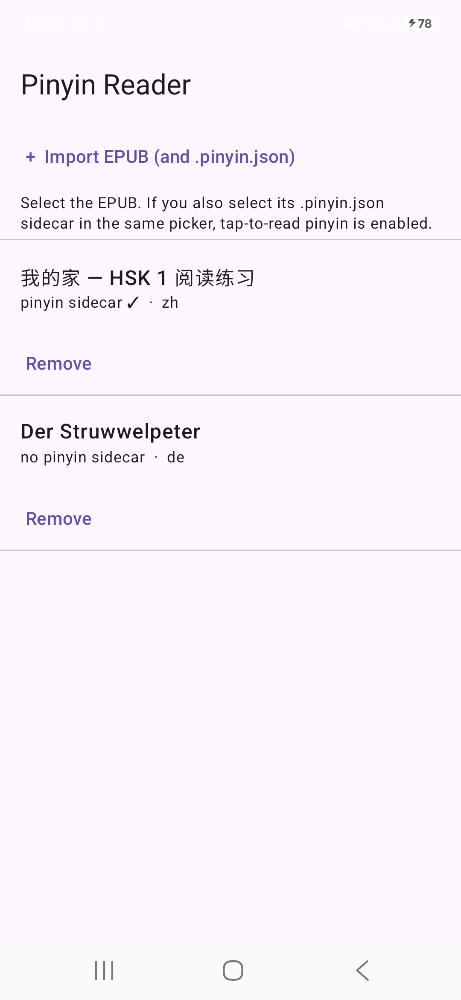

# bookreader

An Android EPUB reader for language learners: **pinyin above the characters**, toggleable,
and **tap any word for its meaning** — no English translation sitting under every line.

Built for reading Chinese (and, eventually, German) books at a level where you can
mostly understand them, and looking up only what you don't.



## How it works

```
   PC (once per book)                          Phone
   ─────────────────                           ─────
   EPUB ──▶ tools/annotate.py ──▶ book.pinyin.json ──┐
             │  jieba segmentation                   │
             │  CC-CEDICT readings                    ▼
             └  pypinyin fallback            EpubParser ──▶ blocks
                                             annotations ──▶ word tokens
                                             WordFlow ──▶ tappable words
                                             Cedict ──▶ definitions on tap
```

Two halves, deliberately separate:

- **Annotation is a PC pass.** Chinese word segmentation and reading disambiguation
  are CPU-heavy and benefit from a big dictionary; doing them once, offline, keeps
  the phone's job small. The app only *reads* the result.
- **The app reads EPUBs directly** (hand-rolled: `java.util.zip` + `XmlPullParser`),
  and merges an optional pinyin sidecar on top.

### The one coupling that matters

The sidecar is keyed by a **hash of each paragraph's text** — not by position:

```json
{ "v": 1, "lang": "zh", "blocks": { "8c23255f8b5af2d8": [["我","wǒ","cedict"], ...] } }
```

The hash strips all whitespace, so the Python extractor and the Kotlin extractor
cannot drift out of sync over formatting differences. If they ever do disagree, the
failure is *"this line shows no pinyin"* rather than *"every line shows the wrong
pinyin"*. `BlockHashAgreementTest` asserts agreement across both extractors.

## Build

Requirements: JDK 17+ (Temurin 21 used here), Android SDK with **platform android-35**
and **build-tools 35.0.1**, and an Android device or emulator.

```bash
# 1. Build the dictionary asset first — it is not vendored into the repo.
cd tools
python build_cedict.py            # writes ../app-android/app/src/main/assets/cedict.db

# 2. Build the APK.
cd ../app-android
./gradlew assembleDebug           # -> app/build/outputs/apk/debug/app-debug.apk
```

On Windows, `./build.sh` wraps this and also sets `JAVA_HOME` (bash's `PATH` does not
reach the `.bat` launcher):

```bash
./build.sh assembleDebug
./build.sh testDebugUnitTest      # extractor-agreement test
```

Test results are written to `app/build/test-results/testDebugUnitTest/*.xml`; Gradle
filters the console, so read the XML for the numbers.

Install over adb, then push the fixtures:

```bash
adb install -r app-android/app/build/outputs/apk/debug/app-debug.apk
adb push hsk1.epub hsk1.pinyin.json /sdcard/Download/
```

Import both files in **one** multi-select gesture — the picker pairs an EPUB with its
`.pinyin.json` by filename. Without a sidecar the book still reads, just without pinyin.

## Annotating a book

```bash
cd tools
pip install pypinyin jieba          # or: uv pip install pypinyin jieba
python build_cedict.py
python annotate.py mybook.epub cedict.txt mybook.pinyin.json
```

`gen_hsk1.py` authors a small HSK1-level fixture from the 150-word vocabulary list —
useful for testing without needing a real graded reader.

## Design notes

These were measured on real books, not assumed. They are the reason the code looks
the way it does.

**CC-CEDICT is the reading source; pypinyin is a last resort.** pypinyin never applies
the neutral tone (轻声), so it is wrong on 16 of 24 common words — 爸爸 → `bà bà`
instead of `bà ba`, and likewise 谢谢, 朋友, 时候, 喜欢, 认识, 东西. These are the first
words a beginner meets, so the error lands exactly where it hurts.
(`tools/check_pypinyin_quality.py` reproduces that table, so the claim can be re-checked
against a newer pypinyin release.) CC-CEDICT encodes
the neutral tone explicitly (`ba4 ba5`; tone 5 = neutral) and is keyed on both scripts,
which also fixes traditional-character readings pypinyin gets wrong (銀行 → `yín xíng`).

**Lookup goes word → character → give up.** jieba groups words into phrases that are
not dictionary headwords (不敢, 兩個, 一座, 一日 — "numeral + measure word" combinations
in particular). Falling back to per-character readings took CC-CEDICT coverage from
**74.4% to 100.0%** on a 367k-token novel (fallbacks: 93,868 → 49). Each token records
which source produced its reading, so a weak reading is visible in the UI rather than
plausible.

**Each word is its own box; no ruby-text library.** The rendering is one small `Column`
per word — pinyin above, the word tappable below. Word-level tap targets come out exact
with no coordinate arithmetic, and pinyin alignment is correct by construction.
The ruby libraries were rejected on evidence: Furiganable documents `onTextLayout` as
unsupported (it swaps in an `AndroidTextView` in some paths), which removes the only way
to hit-test a tapped word by text offset; `androidx.text`'s `RubySpan` is still beta and
requires `compileSdk 37` + AGP 9.1.

**No Readium.** `readium-streamer` 3.4.0 requires `compileSdk 37` plus core library
desugaring (3.2.0+ requires 36). Version 3.1.2 would work — it declares
`minCompileSdk=1` — but the spec coverage was not worth the dependency for plain EPUB3.
Check that field before adopting any AAR:

```bash
unzip -p some.aar META-INF/com/android/build/gradle/aar-metadata.properties
```

**`buildToolsVersion` is pinned** to 35.0.1 because AGP 8.6.1 defaults to 34.0.0, which
is often not installed, and without `cmdline-tools` AGP cannot fetch it.

## Data sources and attribution

- **[CC-CEDICT](https://cc-cedict.org/)** — Chinese–English dictionary, **CC BY-SA 4.0**.
  Used for readings and definitions. It is **not** committed to this repo; `tools/build_cedict.py`
  builds the SQLite asset from the upstream release. Pinyin sidecars (§ above) are derived
  from CC-CEDICT readings and should be treated as carrying the same licence.
- **[jieba](https://github.com/fxsjy/jieba)** — Chinese word segmentation (MIT).
- **[pypinyin](https://github.com/mozillazg/python-pinyin)** — fallback readings only (MIT).
- **[Project Gutenberg](https://www.gutenberg.org/)** — the German test books used during
  development are public domain and are not committed here.

## Known gaps

- **German tap-lookup does nothing.** CC-CEDICT is Chinese-only, so a German EPUB reads
  but has no dictionary behind the tap. German needs its own asset — FreeDict (deu-eng)
  is the small option, an English Wiktionary extract has much better coverage, which
  matters because German inflects hard (*ging* must resolve to *gehen*).
- Pinyin generation is a PC pass, not in-app.
- No LLM gloss, no Anki export, no bookmarks; library metadata is a JSON manifest.
- Only EPUB3 XHTML text is parsed — no fixed-layout, no PDF, no cover thumbnails.

## Licence

MIT — see [LICENSE](LICENSE).
